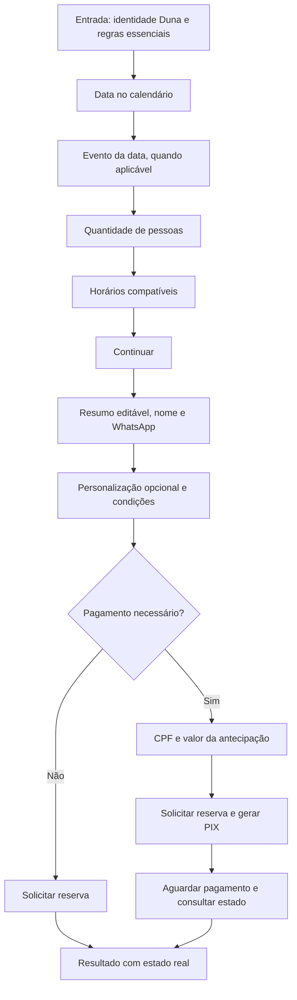

# Jornada pública de reservas — referências LeadsFood e adaptação ao Duna

Data da análise: 29/10/2026, America/Porto_Velho.

Status: pesquisa observada e proposta de adaptação. Este documento não aprova
novas regras comerciais nem representa implementação ou implantação.

## Referências e alcance

- [Giostra Cucina](https://giostracucina.leadsfood.app/reservation).
- [Koya88](https://koya88.leadsfood.app/reservation).

Navegação real nas duas interfaces, com seleção de 30/10/2026, horários e duas
pessoas, avanço até o início de “Seus dados” e retorno. No Koya88, também foi
inspecionada a troca de Salão para Omakase. Nenhum telefone foi informado,
nenhuma reserva foi enviada e nenhum pagamento foi iniciado.

O início da segunda etapa exige celular. Campos posteriores, identificação de
cliente, eventual código de verificação, meios de pagamento, confirmação,
mensagens e cancelamento não foram verificados. A aparência simples desse
campo não comprova autenticação nem consulta segura de cadastro.

Disponibilidade e quantidades abaixo são uma amostra de uma data e horário,
não limites permanentes dos estabelecimentos. A inspeção visual foi feita no
viewport disponível; não constitui teste responsivo completo ou de acessibilidade.

## O que foi observado

### Giostra

- Coluna central com foto, logotipo, introdução, calendário mensal e duas etapas.
- Sequência: data → horário → adultos → crianças e complementos → dados.
- Na amostra: sete horários entre 19h e 22h; opções de 1–6 adultos e 0–4 crianças.
- Motivo da visita com cinco alternativas e observação opcional de até 2.000 caracteres.
- Segunda etapa começa com resumo editável e celular com seletor de país.
- Voltar preservou data, horário, quantidade e motivo selecionados.
- A apresentação anuncia tolerância de 15 minutos e atendimento pelo WhatsApp
  para grupos acima de oito. Há divergência: a introdução cita apenas chegadas
  até 20h, enquanto a seleção oferece horários posteriores.

### Koya88

- Mesmo padrão de etapas, calendário e resumo; identidade visual própria e
  consulta dos horários de funcionamento no topo.
- Sequência: data → modalidade → horário → pessoas → complementos → dados.
- Salão: 18h e 19h; Omakase: 20h30; opções de 1–8 pessoas na amostra.
- Selecionar Omakase acrescenta “Pagamento” ao indicador de etapas e limpa as
  escolhas dependentes de horário e quantidade.
- A introdução distingue preço da experiência (R$ 395) e antecipação (R$ 150),
  anunciada como abatimento do consumo. A base de cálculo não foi comprovada
  no checkout.
- Políticas visíveis incluem tolerância de dez minutos, condições de reembolso
  com antecedência de doze horas e ausência parcial. São regras desse restaurante.
- Foi possível continuar no Salão sem preencher motivo nem observação.
- A etapa de dados também começa por celular com país e resumo editável.

## Por que essa experiência funciona

Esta seção contém avaliação de UX, não resultado de medição de conversão.

1. **Escolhas antes de cadastro:** o cliente encontra uma opção de visita antes
   de investir esforço nos dados de contato.
2. **Revelação progressiva:** cada escolha libera o próximo conjunto de opções,
   reduzindo a quantidade de decisões simultâneas.
3. **Reconhecimento visual:** calendário e botões de horário/pessoas facilitam
   comparar alternativas sem digitar.
4. **Continuidade:** etapas e resumo ajudam a conferir a escolha e voltar para
   corrigir sem recomeçar.
5. **Contexto comercial:** modalidades e pagamento aparecem vinculados à visita.
6. **Identidade do restaurante:** a estrutura é compartilhada, mas cores e
   imagens mantêm a sensação de estar reservando diretamente com a casa.

O texto longo antes do calendário no Koya aumenta a distância até a primeira
ação. Para o Duna, a proposta é uma introdução curta, condições essenciais
visíveis e detalhes próximos da escolha ou do aceite correspondente.

## Comparação com o Duna local

Fontes: `app/components/PublicReservationForm.tsx`, `app/page.tsx`,
`lib/public-reservation-form.ts`, `lib/reservation-payment.ts`,
`docs/funcionalidades/reservas-e-mesas.md` e `docs/funcionalidades/fluxos.md`.

O repositório contém alterações anteriores em andamento. O estado abaixo foi
lido nos arquivos locais e não confirma o que está publicado.

| Elemento | Situação no Duna local | Adaptação proposta |
|---|---|---|
| Reserva → Seus dados | Já existe | Refinar a experiência existente |
| Seleção de data | Lista suspensa | Calendário visual limitado à janela atual |
| Horários e pessoas | Botões; pessoas antes de horário | Manter essa ordem para filtrar capacidade pelo grupo |
| Progressão | Vários blocos permanecem visíveis/desabilitados | Revelar blocos conforme os pré-requisitos e manter contexto |
| Resumo editável | Já existe | Mantê-lo compacto e legível |
| Contato | Nome e WhatsApp; CPF condicional | Preservar coleta mínima e justificativa do CPF |
| Personalização | Decoração e observações em bloco opcional | Refinar rótulos e apresentação |
| Motivo estruturado | Texto livre de ocasião/observações | Eventuais atalhos opcionais; sem criar taxonomia de negócio implicitamente |
| Adultos/crianças | Uma quantidade total | Manter total até definir contagem, idade e impacto em capacidade/cobrança |
| Ambiente/experiência | Eventos e decoração têm contratos próprios | Não tratar decoração como garantia de área ou mesa |
| Pagamento | PIX após criar a reserva; estado consultado por token | Mostrar etapa condicional e valor antes da coleta de CPF |
| Retorno e erros | Preservação de dados e estados de falha já tratados | Preservar ao mudar apresentação |

## Jornada proposta para o Duna

O indicador mostra **Reserva → Seus dados**; quando a escolha exigir cobrança,
passa a **Reserva → Seus dados → Pagamento**. A explicação do valor aparece já
na escolha que gera a cobrança. A ordem gráfica acima não exige uma tela para
cada bloco: são dois passos de formulário, com pagamento condicional posterior.

### Informações para apresentar

- **Entrada:** marca Duna, título acolhedor e regras essenciais curtas.
- **Reserva:** data, quantidade total, horários, evento quando houver e valor
  antecipado quando aplicável. Datas indisponíveis precisam de motivo legível.
- **Dados:** resumo editável, nome e WhatsApp; CPF somente na cobrança.
- **Personalização:** decoração existente e observações opcionais. Pedidos
  especiais dependem de avaliação da equipe.
- **Revisão:** condições aplicáveis, valor e uma ação com consequência clara.
- **Resultado:** solicitado, aguardando pagamento, confirmado ou cancelado,
  conforme o estado retornado; resumo e acesso à ajuda.

Textos propostos: “Quando vamos receber você?”, “Escolha o dia”, “Quantas pessoas
vêm com você?”, “Horários disponíveis” e “Quer acrescentar alguma observação?”.
São sugestões editoriais; reutilizar os textos atuais que já cumprem o objetivo.

## Regras existentes a preservar

Observadas no código/documentação local, sem revalidar produção:

- Fuso America/Porto_Velho; hoje e próximos dez dias; antecedência de oito horas.
- Seleção de 1–30 pessoas; atendimento pela equipe para grupos maiores.
- Tolerância comunicada de vinte minutos.
- Pagamento de grupo a partir de quinze pessoas: R$ 100 no helper atual;
  evento pago usa seu valor com precedência, sem somar as duas cobranças.
- CPF somente quando necessário ao pagamento; sem e-mail no novo formulário.
- Reserva gratuita solicitada não deve ser rotulada automaticamente como confirmada.
- Disponibilidade consultada não garante vaga até a validação na criação.
- PIX é gerado para a reserva já criada; tentar novamente não deve criar outra.
- Acesso usa credencial da reserva. Conhecer um telefone não autoriza consultar
  ou alterar dados de terceiros.

A documentação registra a migration de CPF condicional como pendente de
implantação. Este estudo não a aplicou nem verificou seu estado remoto.
O texto atual comunica conversão em consumação; isso não comprova um mecanismo
contábil de crédito. A adaptação visual não deve criar essa promessa operacional.

## Priorização sugerida

**Primeira entrega — apresentação e navegação:** calendário visual, progressão
dos blocos, condições curtas e contextuais, resumo consistente e indicador de
pagamento condicional. Reutilizar `PublicReservationForm`, os componentes de UI
e os contratos existentes. Preservar a identidade do Duna e usar seus próprios
ativos visuais.

**Decisões de produto posteriores:** categorias de ocasião para relatórios;
adultos/crianças; escolha garantida de ambiente; experiências permanentes;
identificação e recuperação por telefone; políticas de ausência/reembolso.
Cada item muda coleta, operação, autorização ou financeiro e precisa de definição
própria. Não é necessário implementá-los para obter a melhoria principal da jornada.

## Critérios de aceite da futura implementação

1. Calendário utilizável por teclado, seleção única, foco visível e nomes de data
   completos; não depender apenas de cor para seleção/indisponibilidade.
2. Respeitar a janela de datas e agenda existentes, inclusive virada do mês e
   fuso de negócio. Não mostrar meses reserváveis fora do contrato da API.
3. Trocar data, evento ou quantidade revalida escolhas dependentes sem apagar
   contato já informado; voltar preserva o preenchimento.
4. Diferenciar carregamento, erro de consulta e ausência de horários; permitir
   nova tentativa preservando os dados.
5. Explicar valor antes do CPF; conferir fronteira de 14/15 pessoas e evento
   pago com grupo menor. CPF não aparece na reserva gratuita.
6. Mostrar estado real ao concluir; impedir envio duplicado e manter repetição
   de PIX associada à mesma reserva.
7. Ação principal acessível em telas pequenas, sem encobrir campos ou mensagens;
   verificar 320, 390, 768 e 1440 px, teclado e leitura das mudanças de etapa.
8. Texto de horários e condições coerente com configuração vigente; não copiar
   as divergências ou políticas comerciais das referências.

## Evidências e limites desta entrega

- Observação interativa das duas referências e leitura do código local.
- Documento novo; nenhum arquivo de aplicação, migration ou configuração alterado.
- Nenhum teste de código executado: esta entrega é pesquisa e especificação.
- Nenhuma operação no Supabase, pagamento, envio de reserva ou deploy.
- Não houve revisão independente; deve ocorrer sobre a futura implementação.
