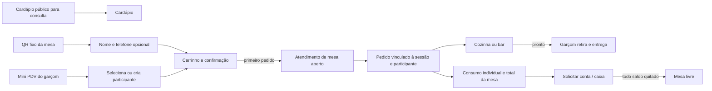
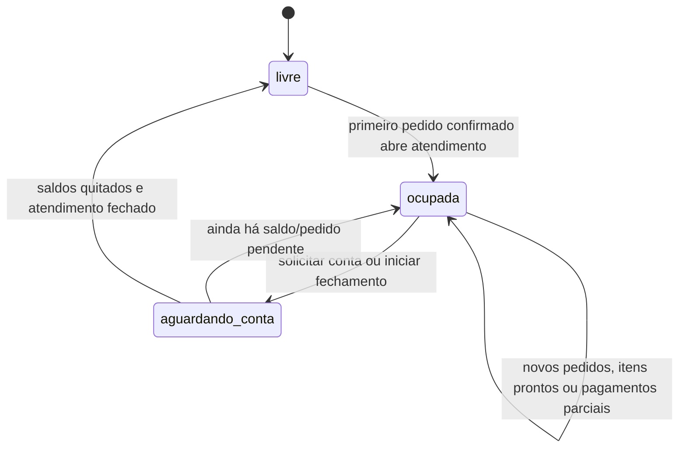

# Cardápio digital, atendimento de mesa e comandas

## Objetivo e fronteiras

Este documento registra as decisões confirmadas para o novo módulo de atendimento de salão: cardápio, pedidos, produção, comandas e fechamento. Ele é um desenho funcional e técnico **planejado**; as tabelas, telas e endpoints descritos ainda não existem no repositório.

O módulo é separado de reservas. Uma `reservation` pode ser ligada opcionalmente a um atendimento de mesa, mas reserva não é comanda e `reservation_payments` não é pagamento de consumo.

- Mesas são cadastros permanentes e começam livres.
- O objeto que abre e fecha é o atendimento/sessão da mesa.
- Abrir ou consultar o QR Code não ocupa a mesa. A confirmação do primeiro pedido pelo QR, ou o primeiro lançamento do garçom, abre o atendimento e ocupa a mesa.
- O cardápio público é apenas de consulta. Pedido acontece pelo QR de uma mesa ou pelo mini PDV; delivery será outro fluxo no futuro.

## Canais e ciclo de vida

Um atendimento aberto em uma mesa é compartilhado: outra pessoa que leia o mesmo QR entra naquele atendimento, identifica-se e recebe sua comanda individual. O garçom pode lançar para uma mesa livre ou ocupada e usa exatamente o mesmo atendimento/comandas que o QR.

## Modelo conceitual

| Conceito proposto | Responsabilidade e relações |
|---|---|
| `table_sessions` | Atendimento da mesa: status, aberta/fechada, horários, quem abriu/fechou e `reservation_id` opcional. Há no máximo um atendimento aberto por mesa. |
| `session_participants` | Pessoa participante, com nome e telefone normalizado opcional; pertence ao atendimento. Não exige conta Supabase nem CPF. |
| `session_access_credentials` | Credencial pública temporária, revogável e armazenada como hash, associada a participante e atendimento. |
| `menu_categories`, `menu_items` | Categorias e itens comercializáveis, preço corrente, foto, disponibilidade e destino de produção. |
| `menu_item_options`, `menu_item_option_values` | Adicionais e escolhas configuráveis, incluindo impacto de preço. |
| `orders`, `order_items` | Pedido e itens. Cada pedido referencia obrigatoriamente `table_session_id` e `session_participant_id`; registra origem `qr` ou `waiter_pos`. Item preserva descrição, opções e preço como snapshot. |
| `production_tickets`, `production_ticket_items` | Lotes para cozinha ou bar, com mesa, hora, observações e estado. |
| `session_payment_allocations` e pagamentos de consumo | Baixas financeiras atribuídas a participante, pedido ou sessão, sem apagar pedidos nem histórico. |
| dados fiscais de fechamento | CPF e demais dados só são solicitados quando houver necessidade fiscal, no fechamento, com acesso e retenção restritos. |

`restaurant_areas` e `restaurant_tables` permanecem a fonte de verdade do cadastro físico. Se o atendimento puder ocupar mesas combinadas no futuro, deve haver uma tabela de junção da sessão para mesas; não reutilizar `reservation_table_assignments`, que representa a janela de reserva.

### Estados mínimos

O estado visual de uma mesa deve refletir o atendimento e seus derivados: **livre**, **ocupada**, **pronto para retirar** e **aguardando conta**. Uma mesa não retorna a livre apenas porque uma pessoa pagou; ela só é liberada depois que não houver pedido ou saldo pendente no atendimento.

## Pedidos, produção e entrega

1. O participante escolhe itens no QR, ou o garçom os lança no mini PDV em nome de uma pessoa existente/nova.
2. A confirmação é transacional: cria atendimento se necessário, participante quando aplicável, pedido e itens com preços congelados.
3. Cada item é roteado para cozinha ou bar conforme a configuração do item.
4. A produção visualiza novos pedidos com mesa, horário e observações. Na primeira fase, só precisa marcar o item/ticket como **pronto**; não há obrigação de usar “em preparo”.
5. O garçom enxerga o que está pronto para retirar, entrega e, se o produto exigir, registra a entrega sem alterar a baixa financeira.

Produção, entrega e pagamento são estados independentes. Um item pronto não é automaticamente pago, e um pagamento não deve remover o histórico operacional do pedido.

## Telas previstas

| Área | Telas e ações |
|---|---|
| Público | Cardápio de consulta, sem carrinho de pedido. |
| QR da mesa | Identificação, cardápio, carrinho, confirmação, pedidos, consumo individual, total da mesa e solicitar conta. |
| Garçom | Mini PDV para abrir/usar mesa, selecionar/criar participante e lançar pedido na comanda correta. |
| Operação | Mapa de mesas como centro operacional; abre mesa para garçom/caixa e mostra livre, ocupada, pronto para retirar e aguardando conta. |
| Cozinha/bar | Fila por destino de produção, mesa, horário e observações; ação principal é marcar pronto. |
| Caixa | Pesquisa/conferência por mesa + nome/telefone, visualiza participantes/consumos, recebe uma pessoa ou a mesa inteira e registra baixas. |
| Administração | Categorias, itens, preços, fotos, adicionais e indisponibilidade. |
| Futuro | Relatórios; desde o primeiro lançamento, pedidos e pagamentos precisam preservar histórico confiável para suportá-los. |

## Integração com a arquitetura atual

A base continua sendo Next.js/React com App Router, Supabase (Auth, Postgres, RLS e Realtime) e Pagar.me.

- Reaproveitar `restaurant_areas`/`restaurant_tables`, o padrão de atualização em tempo real da operação e os componentes administrativos existentes.
- Reaproveitar o padrão de token opaco e hash de `lib/reservation-access.ts` como referência para credenciais públicas, porém com credencial própria para sessão/participante.
- Reaproveitar Pagar.me como referência de integração PIX; o fluxo atual cobra somente taxa de reserva e não deve receber pagamentos de consumo.
- O mapa de mesas pode evoluir a partir da operação do dia, sem substituir a alocação de mesas de reservas existente.

Endpoints e telas devem usar um domínio próprio, por exemplo `table-sessions`, `participants`, `orders`, `production`, `cashier` e `menu`, em vez de ampliar rotas de `reservations` para responsabilidades de comanda.

## Segurança, integridade e privacidade

- QR fixo identifica a mesa, mas não autoriza leitura ou alteração de consumo. Ações de cliente exigem credencial temporária, revogável, limitada ao participante e ao atendimento ativo.
- Nunca expor `service_role` no navegador. Toda tabela nova exposta pelo Data API requer RLS e políticas específicas; uma função privilegiada só deve existir quando indispensável, com autorização explícita e execução restrita.
- A criação do primeiro pedido, a abertura da sessão e a ocupação da mesa precisam ocorrer na mesma transação/idempotência para impedir duas sessões abertas pela corrida de dois QR Codes.
- Preço, nome, quantidade, adicionais e impostos aplicáveis são snapshots em `order_items`; a alteração posterior do cardápio não pode mudar uma conta histórica.
- Baixas financeiras precisam ser idempotentes e auditáveis. Pagamento parcial baixa apenas o consumo atribuído, mantendo saldo, pedidos e trilha de eventos.
- CPF é dado fiscal, não requisito de pedido. Coletar apenas no fechamento quando necessário, com menor retenção possível e acesso restrito.
- Definir explicitamente o que cada participante vê: próprio consumo, total agregado da mesa e, se aplicável, detalhes de itens de terceiros.

## Decisões pendentes antes da implementação

1. A divisão da conta será por participante, por item, percentual ou combinação dessas formas?
2. Quem pode cancelar item, conceder desconto/cortesia, reabrir mesa ou estornar pagamento, e qual auditoria será exigida?
3. A mesa pode ser compartilhada por grupos independentes no mesmo atendimento ou cada grupo deve abrir uma sessão distinta?
4. Qual o comportamento quando o cliente perde a credencial/troca de aparelho: novo ingresso, confirmação por telefone ou auxílio do garçom?
5. Quais integrações fiscais serão necessárias (NF/NFC-e), e quais dados devem compor o documento?
6. Quais itens exigem confirmação de entrega, controle de estoque ou bloqueio por indisponibilidade em tempo real?

## Ordem recomendada

1. Consolidar as decisões pendentes e os papéis de garçom, caixa, produção e administrador.
2. Implementar modelo transacional de atendimento, participante, credencial pública e estado do mapa.
3. Implementar administração de cardápio e lançamento de pedidos pelo mini PDV/QR com tickets de produção.
4. Implementar painéis de cozinha/bar, pronto para retirada e consumo individual/total.
5. Implementar caixa, pagamentos parciais/totais, pedir conta e encerramento seguro da mesa.
6. Integrar PIX de consumo e fiscalidade após definir o contrato de fechamento.
7. Construir relatórios sobre o histórico já preservado.
